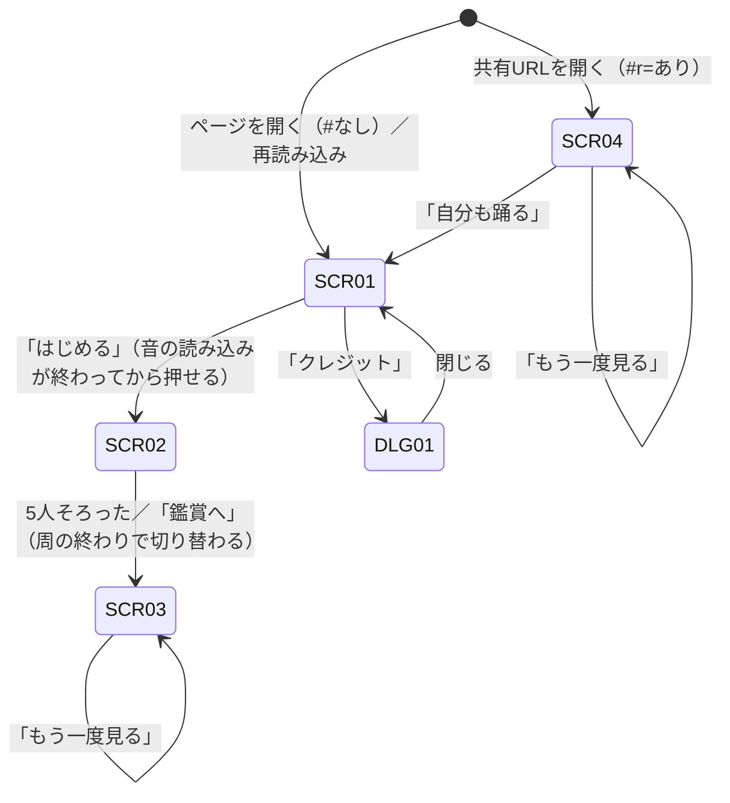

# 画面一覧・遷移図

棒人間ダンシングの画面と、画面の切り替えの条件の正本。画面はブラウザ1枚（1ページ）の中で HTML の表示を切り替えて表示し、ページ遷移はしない（→ [アプリケーション実装方針](../基準書/アプリケーション実装方針.md) 3章）。決定の経緯は [判断ログ](../01_要件定義/判断ログ.md) D23。

URLは2種類だけ。

| URL | 開く画面 |
|---|---|
| `/stick-dance/`（`#` なし） | SCR01 トップ |
| `/stick-dance/#r=<記録>` | SCR04 共有を開いた画面（記録の形は共有の処理設計で決める。未決） |

## 1. 画面一覧

| 画面ID | 画面名 | 目的 | 関連機能 | 画面設計 |
|---|---|---|---|---|
| SCR01 | トップ | タイトルと絵を見せ、「はじめる」で踊る画面へ進む。この画面を出している間に楽器の音を読み込む | F9、F10 | [SCR01_トップ画面](画面設計/SCR01_トップ画面.md) |
| SCR02 | 踊る | キーで棒人間を引っ張って踊り、ループに分身を重ねていく。楽器もこの画面で選ぶ。最初の1周だけ遊び方のヒントを出す | F1〜F6、F9 | 未作成 |
| SCR03 | 鑑賞 | 分身を舞台に並べ、1周ごとに1人ずつ加えて全員の踊りと曲を見る。終わったら共有URLのコピーと、もう一度見るができる | F7、F8 | 未作成 |
| SCR04 | 共有を開いた画面 | 共有URLを開いた人が、遊ばずに鑑賞を見る。見終わったら自分も踊れる | F8 | 未作成 |
| DLG01 | クレジット（窓） | 使った素材の作者とライセンスを出す。トップから開く小さな窓 | F10 | 未作成 |

- 画面が隠れたときの「一時停止中」の表示は、SCR02・SCR03・SCR04 の上に重ねる表示で、画面ではない（→ 4章）
- 全画面に共通の部品は今のところ無い。設ける場合は `画面設計/COM01_全画面共通部品.md` に書く
- 個々の画面設計（`画面設計/SCRxx_*.md`）とモックアップは、本書の後に作る

## 2. 遷移図

## 3. 切り替えの条件

| No | 切り替え元 | 切り替え先 | 条件 | 引き継ぐもの |
|---|---|---|---|---|
| 1 | （ページを開く） | SCR01 | URL に `#r=` が無い。再読み込みも含む | なし |
| 2 | （ページを開く） | SCR04 | URL に `#r=` がある | URL の記録 |
| 3 | SCR01 | SCR02 | 「はじめる」を押した。楽器の音の読み込みが終わるまでは押せない（「準備中」と出す） | なし |
| 4 | SCR01 | DLG01 | 「クレジット」を押した | なし |
| 5 | DLG01 | SCR01 | 閉じた | なし |
| 6 | SCR02 | SCR03 | 5人目が残った、または「鑑賞へ」を押した（1人以上残っているときだけ押せる）。どちらも**周の終わり**で切り替わる。押した周に一定以上鳴らしていれば、その周も分身として残してから切り替える（試作の動き） | 記録（全員のキー入力と楽器） |
| 7 | SCR03 | SCR03 | 「もう一度見る」を押した。鑑賞を頭から再生する | 記録 |
| 8 | SCR04 | SCR04 | 「もう一度見る」を押した | URL の記録 |
| 9 | SCR04 | SCR01 | 「自分も踊る」を押した。URL の `#r=` を消す | なし |
| 10 | SCR02・SCR03 | SCR01 | 再読み込みした。途中の状態は保存しない | なし |

- **鑑賞のあとに踊り直す・最初から作る操作は置かない**（D23。本人の選択）。新しい曲を作るときは再読み込みしてトップから始める（No.10）
- **SCR03 で共有URLをコピーしないまま再読み込みすると、その曲は失われる。** SCR03 にその旨を小さく出す（→ 5章）
- SCR02 の途中でトップへ戻る操作は置かない。やめたいときは再読み込みする（No.10）
- SCR02 の中の操作（楽器を選ぶ・最後の1人を消す・一時停止）は画面の切り替えではないので、本表には書かず SCR02 の画面設計に書く

## 4. 音を始めるきっかけと一時停止

ブラウザは、利用者の操作（キーやクリック）があるまで音を鳴らさない。

| 画面 | 音を始めるきっかけ |
|---|---|
| SCR01 | 「はじめる」を押したとき（楽器の音の読み込み自体は、トップを開いた時点で始める） |
| SCR04 | 「再生する」を押す。URL から直接開くため SCR01 を通らず、まだ操作が無いので、最初に「再生する」を出す |

- 画面が隠れたら（別のタブへ移るなど）、SCR02・SCR03・SCR04 は音と動きを止め、「一時停止中」を重ねて出す。戻ったら続きから（判断ログ D20、技術選定 3.3）
- SCR02 では Space キーでも一時停止できる（試作の動き。画面設計で確定する）

## 5. 画面設計で書き切ること

次は方針が決まっている。文言と細かい表示は各画面設計で決め、本書から消す。

- SCR04 で共有URLが壊れている・版が違うとき: 開けなかったことと理由（壊れている／版が違う）を出し、「自分も踊る」で SCR01 へ進めるようにする。古い版のURLを再生する仕組みは持たない（→ 画面設計書ガイド「入力チェックとメッセージ」、共有の処理設計）
- SCR02 のヒント: 最初の1周の終わりで消す。文言は SCR02 の画面設計で決める
- SCR03 の共有URLのコピー: 「コピーしないまま再読み込みすると、この曲は消える」ことをコピーの操作の近くに1行で出す。コピーに成功・失敗したときの表示は SCR03 の画面設計で決める
- 背景の絵（自宅Macで画像生成。判断ログ D15）が届くまでの SCR02〜SCR04 の仮の見た目（SCR01 は [SCR01_トップ画面](画面設計/SCR01_トップ画面.md) 8章で決めた）
